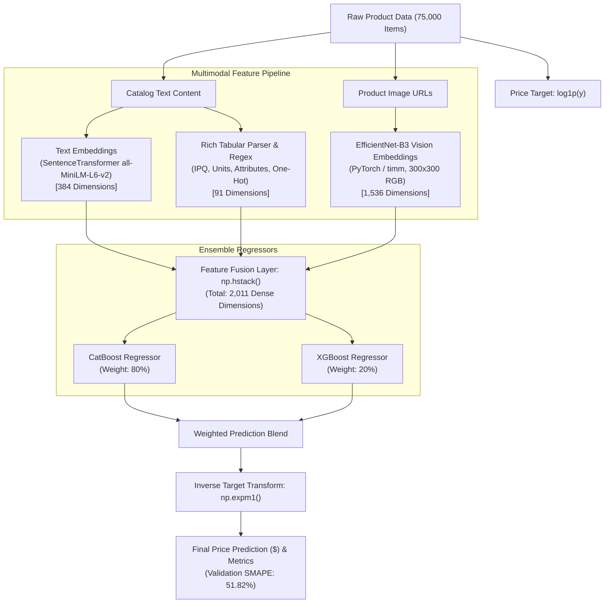

# 🛍️ Multimodal E-Commerce Product Price Predictor

[](https://price-predict-by-syedmuskan.lovable.app)
[](https://price-predict-by-syedmuskan.lovable.app)
[](https://github.com/Muskan-Syed/ecommerce-price-predict)
[](https://github.com/Muskan-Syed/ecommerce-price-predict)
[](https://github.com/Muskan-Syed/ecommerce-price-predict)

An end-to-end multimodal Machine Learning pipeline that predicts e-commerce product prices from unstructured catalog text, extracted tabular attributes, and product images.

---

## 📌 Table of Contents

- [Overview](#-overview)
- [System Architecture](#-system-architecture)
- [Multimodal Feature Engineering (2,011 Features)](#-multimodal-feature-engineering-2011-features)
- [Model Training & Ensembling](#-model-training--ensembling)
- [Performance & Benchmark](#-performance--benchmark)
- [Notebook Pipeline Structure](#-notebook-pipeline-structure)
- [Step-by-Step Setup & Execution](#-step-by-step-setup--execution)
- [Interactive Web App](#-interactive-web-app)
- [Author & Acknowledgments](#-author--acknowledgments)

---

## 🌟 Overview

Pricing products across competitive e-commerce platforms is a complex challenge due to noisy item descriptions, unstandardized units, missing product tags, and varying pack sizes.

This project delivers a **multimodal price prediction system** trained on **75,000 products**. It extracts signals simultaneously from:
1. **Catalog Text**: Product titles, descriptions, and bullet points.
2. **Tabular Attributes**: Units, quantities, dietary/specialty tags, and pack size (IPQ).
3. **Product Images**: Visual features extracted via computer vision backbones.

---

## 🏗️ System Architecture



---

## 🔬 Multimodal Feature Engineering (2,011 Features)

The dataset is transformed into a dense **2,011-dimensional feature matrix** across three distinct pipelines:

| Modality | Extractor / Method | Dimensions | Description |
| :--- | :--- | :---: | :--- |
| **Text Semantics** | `SentenceTransformer('all-MiniLM-L6-v2')` | **384** | Captures latent semantics from concatenated descriptions and bullet points. |
| **Tabular Attributes** | Regex parsing + Sklearn Pipeline (`ColumnTransformer`, `StandardScaler`, `OneHotEncoder`) | **91** | Extracts Pack Size, Item Size (oz), Units, IPQ, and binary flags (`is_gluten_free`, `is_organic`, `is_non_gmo`, `is_sugar_free`, `is_kosher`). |
| **Visual Embeddings** | `timm.create_model('efficientnet_b3', pretrained=True)` | **1,536** | Extracts normalized visual feature vectors from 300x300 product images. |
| **Total Fused Matrix** | `np.hstack([train_text, train_tabular, train_image])` | **2,011** | Full multimodal representation for `X_train` & `X_test`. |

---

## ⚡ Model Training & Ensembling

- **Target Normalization**: Models are trained on `np.log1p(price)` to stabilize variance across wide price distributions ($1 to $500+).
- **CatBoost Regressor (80% Weight)**: Optimized for tabular-dense matrices, high dimensional categorical interactions, and fast tree-building.
- **XGBoost Regressor (20% Weight)**: Adds complementary gradient-boosted decision tree regularization.
- **Weighted Blending Formula**:
  $$\hat{y}_{\text{final}} = \exp\left(0.80 \cdot \hat{y}_{\text{CatBoost}} + 0.20 \cdot \hat{y}_{\text{XGBoost}}\right) - 1$$

---

## 📊 Performance & Benchmark

Predictions are evaluated using **Symmetric Mean Absolute Percentage Error (SMAPE)** on the actual dollar scale:

$$\text{SMAPE} = \frac{100\%}{n} \sum_{i=1}^{n} \frac{|\hat{y}_i - y_i|}{\frac{|\hat{y}_i| + |y_i|}{2}}$$

### Benchmark Results

| Model / Pipeline | Validation Metric | Scale |
| :--- | :---: | :---: |
| CatBoost Solo | ~60.71% SMAPE | Log / Intermediate |
| XGBoost Solo | MAE 0.257 | Log-scale |
| **CatBoost (80%) + XGBoost (20%) Blend** | **51.8239% SMAPE** | **Real Dollar Scale** |

---

## 📁 Notebook Pipeline Structure

All code is organized inside [`Price_Prediction_Model_whole_code_gcolabfile.ipynb`](file:///c:/Users/DELL/Downloads/e-commerce/Price_Prediction_Model_whole_code_gcolabfile.ipynb):

```text
Price_Prediction_Model_whole_code_gcolabfile.ipynb
├── Step 0: Google Drive Mounting & Environment Setup
├── Step 1: Data Preprocessing & Fast IPQ / Token Extraction
├── Step 2: Automated Multi-Threaded Image Downloader & Validator
├── Step 3: Dataset File Indexing & Directory Separation
├── Step 4: Catalog Content Attribute Regex Extraction
├── Step 5: SentenceTransformer Text Embedding Pipeline (384-d)
├── Step 6: EfficientNet-B3 Visual Embedding Pipeline (1536-d)
├── Step 7: Tabular Scikit-Learn Pipeline & One-Hot Encoding (91-d)
├── Step 8: Multimodal Feature Concatenation (2,011-d)
├── Step 9: CatBoost Model Training & Checkpointing (.cbm / .pkl)
├── Step 10: XGBoost Model Training & MAE Optimization
├── Step 11: 80:20 Ensembling & Blended Predictions
└── Step 12: Real-Scale SMAPE Evaluation & Submission Generation
```

---

## 🚀 Step-by-Step Setup & Execution

### Option A: Run in Google Colab (Recommended)

1. Upload [`Price_Prediction_Model_whole_code_gcolabfile.ipynb`](file:///c:/Users/DELL/Downloads/e-commerce/Price_Prediction_Model_whole_code_gcolabfile.ipynb) to [Google Colab](https://colab.research.google.com/).
2. Select a GPU runtime (**Runtime** → **Change runtime type** → **T4 GPU**).
3. Mount Google Drive and run the cells sequentially.

### Option B: Run Locally

1. **Clone the repository**:
   ```bash
   git clone https://github.com/Muskan-Syed/ecommerce-price-predict.git
   cd ecommerce-price-predict
   ```

2. **Create a virtual environment & install requirements**:
   ```bash
   python -m venv venv
   source venv/bin/activate  # On Windows: venv\Scripts\activate
   pip install torch torchvision timm sentence-transformers catboost xgboost scikit-learn pandas numpy pillow tqdm
   ```

3. **Launch Jupyter Lab**:
   ```bash
   jupyter lab
   ```
   Open `Price_Prediction_Model_whole_code_gcolabfile.ipynb` and execute.

---

## 🌐 Interactive Web App

Test predictions interactively in real time:

👉 **[https://price-predict-by-syedmuskan.lovable.app](https://price-predict-by-syedmuskan.lovable.app)**

- Paste any raw product catalog text or bullet points.
- Provide an optional product image link.
- Get instant predicted price, price-per-unit, market range (min/max), and IPQ breakdown.

---

## 👩‍💻 Author & Acknowledgments

- **Developer**: [Muskan Syed](https://github.com/Muskan-Syed)
- **Application**: [AI Product Price Predictor Live App](https://price-predict-by-syedmuskan.lovable.app)
